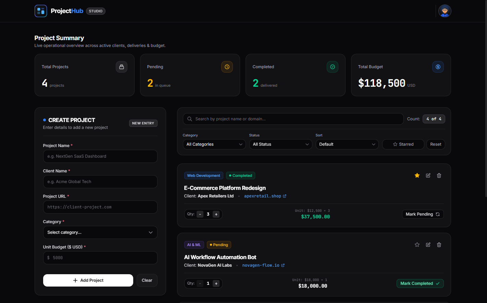
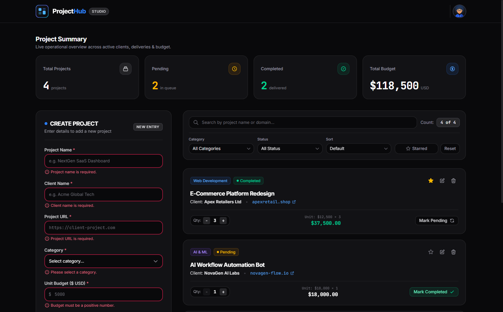
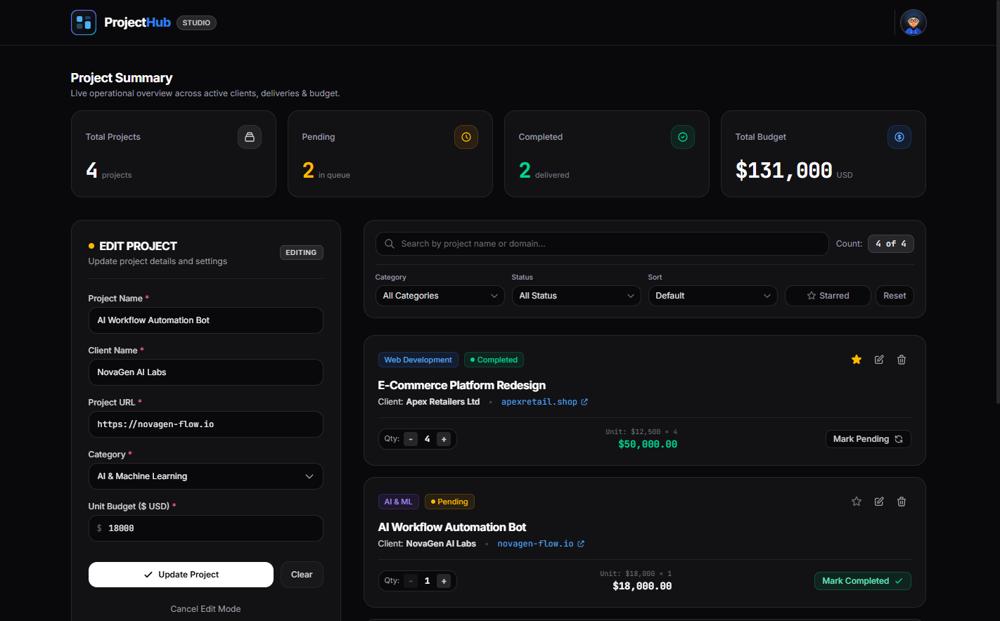

# ProjectHub — Modern Workspace

A modern, responsive, and feature-packed Project Management Workspace built with **React**, **Vite**, and **Tailwind CSS v4**. Developed as part of the **Batch 5 — React & Next.js Assignment 02** (Learn with Sumit).

---

## 📸 Application Previews

### Dashboard & Operational Overview


### Real-time Field-level Form Validation


### Dynamic Project Management & Live Metrics


---

## ✨ Features

### 1. 📊 Live Operational Summary
- **Total Projects**: Dynamically tracks the total number of projects in the workspace.
- **Pending Projects**: Real-time counter of projects currently in the queue.
- **Completed Projects**: Real-time counter of projects delivered.
- **Total Budget**: Dynamically aggregates total project value across all active projects based on `Unit Budget × Quantity`.

### 2. 📝 Project Creation & Update (CRUD)
- **Create New Projects**: Left-hand workspace form to capture Project Name, Client Name, Project URL, Category, and Unit Budget.
- **Edit Mode**: Clicking any card's edit button populates the form with existing details, switches mode to *Editing*, and smoothly scrolls into view. Supports cancellation via the *Cancel Edit Mode* button.
- **Delete Projects**: Clicking any card's delete icon removes the project and immediately recalculates the operational summary.
- **Clear Form**: Clicking *Clear* wipes out all input values and resets any active validation errors.

### 3. 🛡️ Robust Field-level Validation
- **Required Fields**: Ensures Project Name, Client Name, Project URL, Category, and Budget are provided before submission.
- **URL Format Validation**: Verifies that the entered URL contains a valid domain structure.
- **Positive Budget Constraint**: Enforces positive numeric values for project budgets.
- **Immediate Error Cleanup**: Field errors automatically vanish as soon as the user starts correcting them.

### 4. ⚡ Dynamic Quantity & Budget Engine
- **Quantity Controller**: Increase (`+`) or decrease (`-`) work units for each project (minimum 1 unit).
- **Auto Calculation**: Dynamically computes `Unit Budget × Quantity = Total Project Amount` per card and updates the global summary metrics in real-time.

### 5. 🔄 Status & Star / Favorite Controls
- **Status Toggle**: Seamlessly switch between **Pending** and **Completed** with dynamic visual indicators (amber vs. emerald badge dots and contextual action buttons).
- **Favorite System**: Star and unstar any project to highlight critical assignments.

### 6. 🔍 Unified Search, Filtering & Multi-criteria Sorting
- **Case-insensitive Search**: Search across project names, clients, and domain URLs. Includes a single-click search clear (`X`) button.
- **Category Filter**: Filter projects by Web Development, Mobile App, UI/UX Design, Cloud / DevOps, AI & ML, or Branding & Growth.
- **Status Filter**: View all projects or restrict to *Pending* or *Completed*.
- **Starred Filter**: Toggle viewing only favorite/starred projects.
- **Multi-criteria Sorting**:
  - Name: A to Z (Ascending)
  - Name: Z to A (Descending)
  - Budget: Low to High
  - Budget: High to Low
- **Combined Pipeline**: Search, filter, and sort operate cooperatively on the active dataset with a live counter badge (`X of Y`).
- **Empty State**: Displays an empty state illustration and message with a single-click *Reset Filters* button when no matching results are found.

---

## 🛠️ Technology Stack

- **Framework**: [React](https://react.dev/) (Vite powered)
- **Styling**: [Tailwind CSS v4](https://tailwindcss.com/)
- **Icons**: Accessible Inline SVG icons (matching the original design template)
- **Typography**: Inter & JetBrains Mono (Google Fonts)
- **Zero Third-party Runtime Libraries**: Built entirely with native React state management (`useState`, `useMemo`, `useEffect`) and pure modern JavaScript.

---

## 📁 Project Structure

```text
rnext-5-assignments/
├── public/
│   └── assets/              # SVG illustrations, avatar & logo
├── screenshots/             # Application preview images (dashboard, validation, management)
├── src/
│   ├── components/
│   │   ├── Controls/
│   │   │   └── ProjectControls.jsx  # Search, filter, starred & sort controls
│   │   ├── Form/
│   │   │   └── ProjectForm.jsx      # Create/Edit project form with validation
│   │   ├── Projects/
│   │   │   ├── EmptyState.jsx       # No results empty state graphic
│   │   │   ├── ProjectCard.jsx      # Project card with qty & status controls
│   │   │   └── ProjectList.jsx      # Projects collection renderer
│   │   ├── Summary/
│   │   │   ├── ProjectSummary.jsx   # Top metrics dashboard section
│   │   │   └── SummaryCard.jsx      # Individual summary metric card
│   │   ├── Footer.jsx               # Minimalist footer
│   │   └── Header.jsx               # Studio header with navigation & avatar
│   ├── data/
│   │   └── initialProjects.js       # Preloaded workspace data
│   ├── utils/
│   │   └── formatters.js            # Currency, URL validation & style helpers
│   ├── App.jsx                      # Root application & state coordinator
│   ├── index.css                    # Tailwind CSS v4 imports & custom fonts
│   └── main.jsx                     # Application entry point
├── index.html                       # HTML template with fonts and dark theme
├── package.json
└── vite.config.js                   # Vite configuration with Tailwind CSS v4
```

---

## 🚀 Getting Started

Follow these steps to run the application locally:

### 1. Prerequisites
Ensure you have **Node.js** (v18 or higher) installed on your system.

### 2. Install Dependencies
```bash
npm install
```

### 3. Start Development Server
```bash
npm run dev
```
Open your browser and navigate to `http://localhost:5173`.

### 4. Build for Production
```bash
npm run build
```

---

## 📜 License & Acknowledgments

This project is developed for educational purposes.
All rights reserved © 2026.
